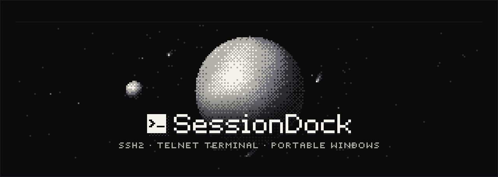
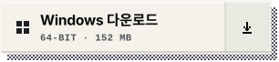

<div align="center">

<a href="https://sessiondock.norahc.com/">
  
</a>

<h1>Windows용 SSH2·Telnet 터미널</h1>

<p>
  <a href="https://github.com/hibye-ai/SessionDock/releases/tag/v0.1.8">
    <picture>
      <source media="(prefers-color-scheme: dark)" srcset="docs/cta-download-dark.svg">
      <source media="(prefers-color-scheme: light)" srcset="docs/cta-download-light.svg">
      
    </picture>
  </a>
</p>

<p>
  <a href="https://sessiondock.norahc.com/">공식 사이트</a>
  &nbsp;·&nbsp;
  <a href="#주요-기능">주요 기능</a>
  &nbsp;·&nbsp;
  <a href="#windows에서-설치와-실행">설치와 실행</a>
  &nbsp;·&nbsp;
  <a href="https://github.com/hibye-ai/SessionDock/releases">변경 사항</a>
  &nbsp;·&nbsp;
  <a href="#개발과-빌드">개발과 빌드</a>
</p>

<br>

<a href="https://sessiondock.norahc.com/sessiondock-demo-v54.png">
  
</a>

</div>

---

## 주요 기능

<table>
  <tbody>
    <tr>
      <td width="34%" valign="top"><code>01</code>&nbsp;&nbsp;<strong>세션 정리 · 빠른 검색</strong></td>
      <td valign="top">장비를 폴더와 즐겨찾기로 체계화하고 <kbd>Ctrl</kbd>+<kbd>K</kbd> 검색으로 바로 접속합니다. SecureCRT, PuTTY, WindTerm의 접속 목록 가져오기도 지원합니다.</td>
    </tr>
    <tr>
      <td valign="top"><code>02</code>&nbsp;&nbsp;<strong>다중 탭 · 분할 화면</strong></td>
      <td valign="top">상단 빠른 연결 바에서 SSH2·Telnet으로 접속하고, 여러 세션을 탭 전환과 좌우·상하 분할 화면으로 동시에 작업합니다.</td>
    </tr>
    <tr>
      <td valign="top"><code>03</code>&nbsp;&nbsp;<strong>구문 강조 출력</strong></td>
      <td valign="top">스위치·라우터의 인터페이스 상태, IP 주소, 연결 여부를 색상으로 강조합니다.</td>
    </tr>
    <tr>
      <td valign="top"><code>04</code>&nbsp;&nbsp;<strong>명령 입력 바 · 동시 전송</strong></td>
      <td valign="top">하단 명령 바에서 이력(<kbd>↑</kbd> <kbd>↓</kbd>), 추천(<kbd>Ctrl</kbd>+<kbd>Space</kbd>), 민감 입력을 지원하며 연결된 여러 탭에 명령을 일괄 실행·동시 전송합니다.</td>
    </tr>
    <tr>
      <td valign="top"><code>05</code>&nbsp;&nbsp;<strong>자동 로그 · SFTP</strong></td>
      <td valign="top">로그를 켜면 세션 입출력을 파일에 기록하고, SSH 연결에서는 내장 SFTP 탐색기로 파일을 주고받습니다.</td>
    </tr>
  </tbody>
</table>

## Windows에서 설치와 실행

<table>
  <tbody>
    <tr>
      <td width="34%" valign="top"><strong>압축 해제 후 실행</strong></td>
      <td valign="top">Windows x64용 <a href="https://github.com/hibye-ai/SessionDock/releases/tag/v0.1.8"><code>SessionDock.zip</code></a>을 새 폴더에 압축 해제하고 <code>SessionDock.exe</code>를 실행하세요.</td>
    </tr>
    <tr>
      <td valign="top"><strong>무결성 검사 (SHA-256)</strong></td>
      <td valign="top"><code>Get-FileHash -Algorithm SHA256 .\SessionDock.zip</code>의 출력값을 <a href="https://github.com/hibye-ai/SessionDock/releases/tag/v0.1.8">GitHub Release</a>의 SHA-256과 비교하세요.</td>
    </tr>
    <tr>
      <td valign="top"><strong>업데이트 채널</strong></td>
      <td valign="top">이 버전의 기본 업데이트 채널은 공식 SessionDock 서버이며, 설정에서 로컬 폴더 업데이트를 선택할 수 있습니다.</td>
    </tr>
  </tbody>
</table>

## 개발과 빌드

Windows x64와 Node.js 24 이상을 사용합니다. 프로젝트 루트에서 다음 명령을 실행합니다.

```powershell
powershell.exe -NoProfile -ExecutionPolicy Bypass -File scripts/prepare-windows.ps1
npm.cmd ci
npm.cmd run dev
```

준비 스크립트는 Python 공식 임베디드 런타임을 내려받아 고정 SHA-256을 검증합니다. 앱에 포함되는 Python, Electron/Chromium 및 npm 의존성의 라이선스는 각 배포물의 고지를 따릅니다.

```powershell
npm.cmd test
npm.cmd run test:integration
npm.cmd run dist -- --build-only
node node_modules/electron/install.js
node scripts/verify-package.cjs
```

Windows 빌드 결과는 `dist/SessionDock.zip`에 생성됩니다. 단위 시험과 통합 시험은 합성 데이터와 루프백 서버를 사용합니다.

## 라이선스

SessionDock 소스는 MIT 라이선스로 제공됩니다. 자세한 내용은 [LICENSE](LICENSE)를 참고하세요.
